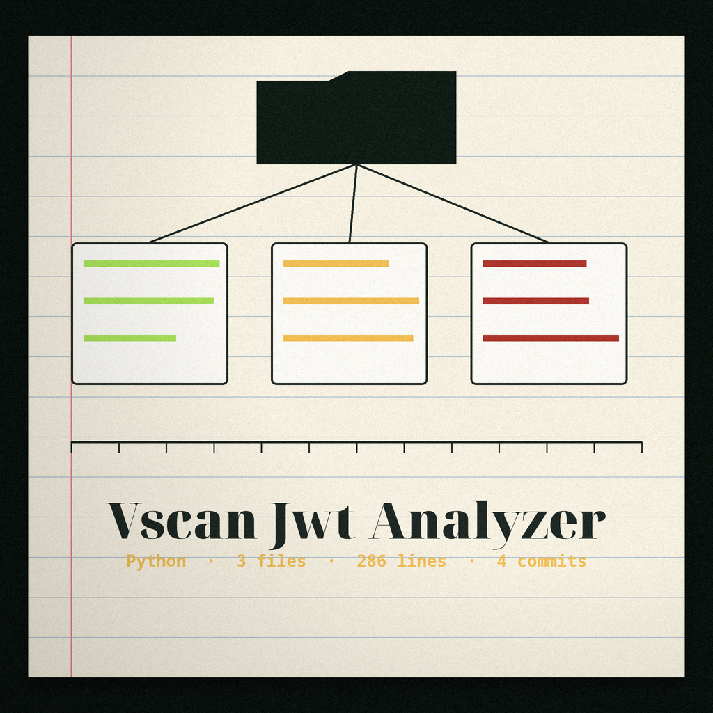
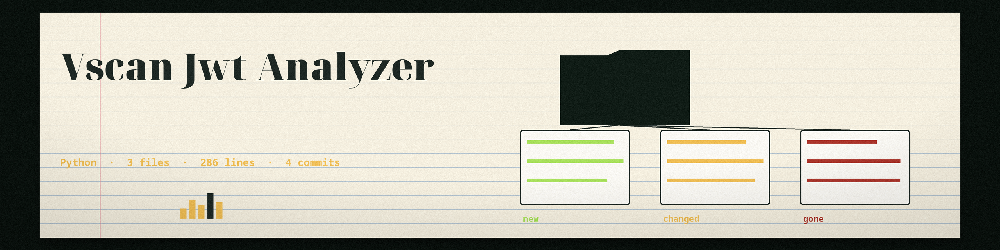

# vscan-jwt-analyzer
Analyzes JWT (JSON Web Tokens) for common vulnerabilities such as weak algorithms, missing expiration, and guessable HMAC secrets.

## Install
`git clone https://github.com/ShadowGuard-AI/vscan-jwt-analyzer`

No third-party packages are required; the tool uses only the Python standard library.

## Usage
`python3 main.py <jwt> [options]`

Example: `python3 main.py eyJhbGciOiJIUzI1NiJ9.eyJzdWIiOiIxIn0.signature --secret secret`

## Parameters
- `jwt`: The JWT to analyze. It must have exactly three segments (header, payload, signature); any other segment count is rejected and no analysis is performed.
- `-v`, `--verbose`: Enable verbose output (debug logging).
- `--secret`: Operator supplied candidate secret for the weak secret test. May be given more than once. Results are reported by candidate index only; candidate values are never printed.
- `--secret-file`: Path to a file with one operator supplied candidate secret per line for the weak secret test. Results are reported by candidate index only.
- `--show-payload-values`: Show decoded payload claim values in full. By default only claim names and value types are shown and values are masked.
- `-h`: Show help message and exit.

## Behaviour notes
HMAC signatures (HS256, HS384, HS512) are verified with the standard library against operator supplied candidates only; no secret is built into the tool. A token with alg `none` is reported as unverifiable, never as a successful verification. The `exp`, `iat`, and `nbf` claims must be JSON numbers (NumericDate values): a claim carrying a string, a boolean, or any other non-number value is flagged as not evaluable instead of being silently skipped or compared against the clock. An embedded `jwk` header value is never printed, because it can carry key material; the rest of the header is shown as decoded. A token that cannot be decoded exits non-zero.

## License
MIT (see LICENSE).
